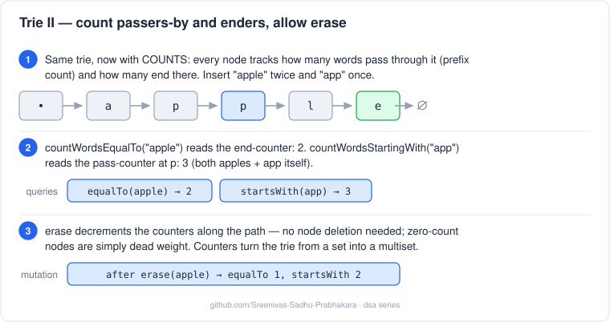

# Implement Trie II (Counted)

> Striver SDE Sheet 186 · Day 27 Trie — swap the boolean flag for two counters (ends-here, passes-through) and duplicates, prefix counts and erasure all fall out. Go, stdlib only, tested.

## Problem

A trie supporting duplicate insertions, `CountWordsEqualTo`, `CountWordsStartingWith`, and `Erase` of a single occurrence — the multiset upgrade of #185.

## Approach

Replace `isWord` with `wordCount` and add `passCount` maintained on every node an insert touches. Both queries become single walks ending in a field read — the prefix count needs no subtree traversal, because the counting was done at insert time (the classic move of paying at write time for O(1) reads). Erase is insert with decrements, **guarded** by an existence check first: decrementing along a path for a word that isn't stored would corrupt counts for every word sharing the prefix — the test attacks exactly that. Physical node removal on zero counts is an optional tidy-up; counts alone keep the structure correct.

**Complexity:** all operations O(len(word)); space O(total characters).

## Visual walkthrough

Read the picture top to bottom — each numbered frame is one moment of the algorithm
running on this repo's test example.

## Run

    go test ./...   # verify
    go run .        # demo

---

One of 191 repos solving Striver's SDE Sheet in Go — stdlib only, one problem per repo, every solution tested. Browse the set: [`dsa-*` repos](https://github.com/Sreenivas-Sadhu-Prabhakara?tab=repositories&q=dsa-&type=source).
